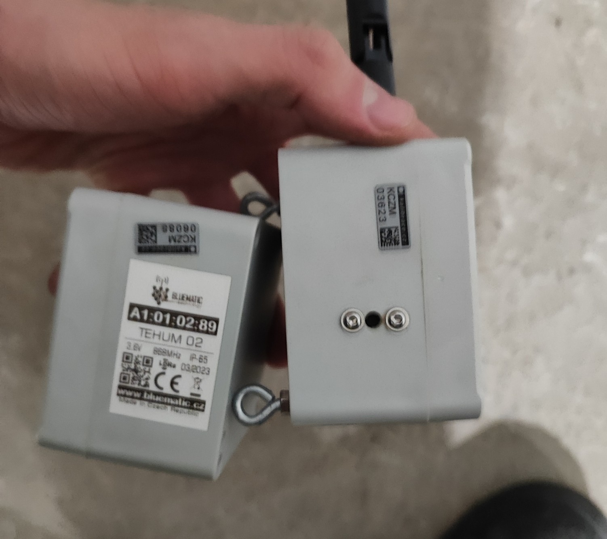

# Dokumentace – Automatizace zadávání kalibrací TeHum měřidel

Práce je rozdělena do 3 částí:

| Část | Soubor | Pro koho |
|---|---|---|
| Protokol | [protokol.md](protokol.md) | Komise, vedoucí: jak práce probíhala, zdroje, co je vlastní práce |
| Uživatelská dokumentace | [uzivatelska.md](uzivatelska.md) | Kdokoli, kdo chce aplikaci nainstalovat, spustit a ověřit, že funguje |
| Programátorská dokumentace | [programatorska.md](programatorska.md) | Oponent a vedoucí: orientace ve zdrojovém kódu |

## Stručně o práci

Ve firmě Performance4 s.r.o se kalibrace digitálních teploměrů a vlhkoměrů (TeHum) zapisuje několikastupňovým ručním procesem přes Microsoft Forms, Power Automate, SharePoint a Excel (viz [analýza](../analyza/Notes.md)). Práce:

1. proces zmapovala (BPMN diagram a přehled entit ve složce [`analyza`](../analyza)),
2. nahradila ruční vyplňování formuláře desktopovou aplikací v Pythonu: kódy měřidel se načítají čtečkou, naměřené hodnoty se zadají ručně a aplikace je přes UI automatizaci (Playwright) odešle do Microsoft Forms.



*Měřidla TeHum 02 (Bluematic). Na štítku každého z nich je kód `KCZM#####`, který aplikace načítá čtečkou.*

## Struktura repozitáře

```
analyza/        mapování původního procesu (BPMN, entity, poznámky)
dokumentace/    tato dokumentace
src/            zdrojový kód aplikace
.env.example    vzor konfigurace
pyproject.toml  závislosti (uv)
```
