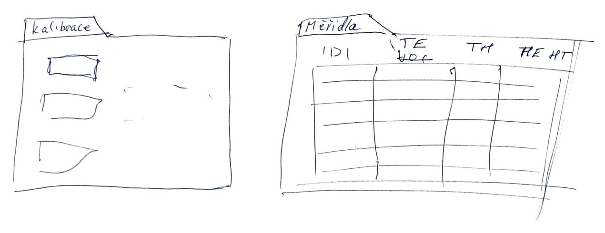

# Protokol o práci

## Zadání

Zmapovat stávající proces kalibrace TeHum měřidel ve firmě Performance4. Navrhnout prototyp zlepšení jeho první část (zadání do Microsoft Forms, přepis flow do SharePoint seznamu `TableAction`, ruční zadání naměřených hodnot) python aplikací.

## Průběh práce|

1. **Analýza.** do [Prompt](../analyza/Prompt.md), jsem zapsal instrukce pro AI agenta na vytvoření diagramu procesu [BPMN](../analyza/before.bpmn), zároveň jsem tam uvedl seznam odkazů na všechny entity vystupující v procesu. Následně jsem nechal vytvořit a zkontroloval zbylé soubory v /analyza
2. **Volba přístupu.** Rozhodl jsem se, že bude nejednosuduší vytvořit automatizaci zadávání MS Forms přes UI, protože uživatel stále vidí co počítač dělá, právě z toho důvodu jsem se rozhodl nepoužívat Graph API. Přihlášení do Microsoft 365 se řeší uloženým stavem prohlížeče (`storage_state`), takže se nemusí ukládat heslo.
3. **Datový model.** Pravidla pro vstup (formát kódu měřidla, rozsah vlhkosti 0–100 %, formát kampaně `RRRR-MM`) jsou na jednom místě v `schemas.py`; UI je z něj generováno.
4. **UI.** Okno se společnými údaji, tabulka měřidel, okno pro čtečku (čtečka se chová jako klávesnice a po kódu pošle Tab/Enter). Vytvářel jsem ho pomocí AI agenta, kterému jsem poslal fotku wireframu na papíře. Agent pomocí schemas a wireframu vytvořil jednoduché tkinter UI, které umožňuje validaci zadaných dat proti modelu v `schemas.py`. Výsledná okna jsou v [uživatelské dokumentaci](uzivatelska.md#ovládání).

   

   *Ručně kreslený wireframe: vlevo okno „Kalibrace" (společné údaje), vpravo okno „Měřidla" (tabulka se sloupci IDI, TE, TK, HE, HK).*
5. **Odeslání.** Pro každé měřidlo se otevře formulář, vyplní se a odešle; chyby se sbírají a zobrazí na konci.

## Co je vlastní práce a co ne

**Vlastní práce:** analýza procesu, zadání, návrh řešení, wireframe UI, řízení AI agenta a kontrola jeho výstupů, testování.

**Využití umělé inteligence.** Použil jsem AI agenta Claude Code (Anthropic) k těmto účelům: vytvoření diagramu procesu (BPMN) a ostatních souborů ve složce `analyza/` podle mých instrukcí, vytvoření uživatelského rozhraní v Tkinteru podle mého wireframu a datového modelu, uhlazení kódu a odstraňování chyb a pomoc při psaní této dokumentace. AI jsem také využil ke konzultaci svých nápadů. Žádný obsah vygenerovaný AI nebyl do práce zařazen bez mé důkladné kontroly.

**Převzaté / cizí:**
- Knihovny: [Playwright](https://playwright.dev/python/), [Pydantic](https://docs.pydantic.dev/), [python-dotenv](https://pypi.org/project/python-dotenv/), Tkinter (součást Pythonu).
- Formulář Microsoft Forms, Power Automate flow, SharePoint seznamy a Excel s kalibračním listem existovaly před prací a nejsou její součástí. Aplikace s nimi pouze komunikuje.

## Funguje práce?

Analýza byla již několikrát interně použita ve firmě.

V rámci testování jsem vytvořil na školním SharePointu web a na něm SharePoint list, simulující list TableAction a k němu zadávací formsy, které mají všechna duležitá pole, která jsou ve forms v Performance4

## Známá omezení

- Testy automatické neexistují; ověřování je ruční.
- Popisky polí ve Forms jsou hledány podle přístupnostních názvů (např. `ItemCode, empty, field editor.`). Změna formuláře nebo jeho jazyka aplikaci rozbije.
- Aplikace prototypuje jen vstupní část procesu. Generování kalibračního listu zůstává v Excelu.